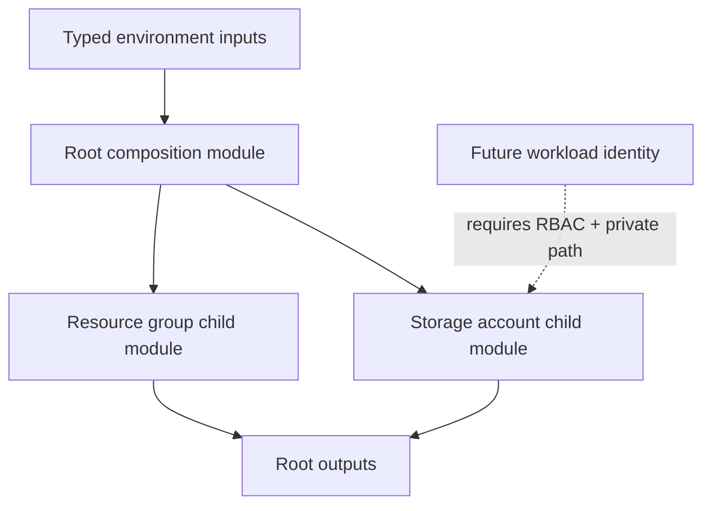

<div align="center">


### Storage infrastructure as code · Reusable contracts · Private by default

[](https://developer.hashicorp.com/terraform)
[](https://learn.microsoft.com/azure/storage/)
[](https://learn.microsoft.com/azure/storage/common/storage-security-guide)

**A focused Terraform module composition lab for creating Azure resource groups and StorageV2 accounts through typed inputs and reusable child modules.**

[Architecture](#-architecture) · [Modules](#-module-contracts) · [Quick start](#-quick-start) · [Security model](#-storage-security-model)

</div>

> [!NOTE]
> This is a reusable-module learning project with CI validation. It does not claim a live Azure deployment. The module deliberately disables public network access and shared-key access by default; consuming workloads need an approved private path and identity authorization.

## The problem

Storage resources are easy to create but easy to expose incorrectly. This lab focuses on a repeatable module interface and conservative defaults so storage provisioning can be composed, reviewed and extended without embedding credentials or public-access assumptions.

## Architecture



## Module contracts

| Module | Responsibility |
|---|---|
| `azurerm_resource_group` | Create one or more resource groups with stable `for_each` keys |
| `azurerm_storage_account` | Create StorageV2 accounts with secure transport/network defaults |
| Root module | Compose child modules and expose resource identifiers |

Storage account resource-group names are explicit inputs. Ensure each referenced resource group is created by this configuration or already exists in the selected subscription.

## Quick start

### Requirements

- Terraform CLI 1.6+.
- Azure CLI authenticated to a non-production test subscription for planning.
- Permissions to create resource groups and storage accounts.

### Configure

Copy the example variables file and edit it:

```bash
cp terraform.tfvars.example terraform.tfvars
```

Choose a globally unique Storage account name (3–24 lowercase letters and numbers). Confirm the target resource group and region.

### Validate

```bash
terraform fmt -check -recursive
terraform init -backend=false
terraform validate
```

### Review a plan

After backend and provider authentication are configured for the intended environment:

```bash
terraform plan -out=tfplan
terraform show -no-color tfplan
```

Do not apply until the full plan, region/SKU availability and estimated cost have been reviewed. This repository does not configure remote state or create private endpoints.

## Storage security model

- HTTPS-only transport and TLS 1.2 minimum.
- Shared-key authentication disabled.
- Public network access disabled.
- Private blob container.
- No credentials or real variable files committed.

**Connectivity and authorization are separate requirements.** Add a Private Endpoint, private DNS zone/link and a valid VNet route for private connectivity. Assign narrowly scoped Microsoft Entra data-plane roles to the consuming workload identity. Validate DNS resolution and blob operations from the actual client network.

## CI and validation

The GitHub Actions workflow checks formatting, initializes without a remote backend, validates the root composition and runs an advisory Checkov scan. These checks do not deploy Azure resources or prove that a workload can access the storage account.

## Repository map

```text
modules/
  azurerm_resource_group/
  azurerm_storage_account/
main.tf
variables.tf
outputs.tf
terraform.tfvars.example
.github/workflows/
docs/
```

## Production-hardening checklist

- [ ] Configure encrypted remote state, versioning, locking and access restrictions.
- [ ] Add Private Endpoint and private DNS integration.
- [ ] Assign least-privilege data-plane RBAC to workload identities.
- [ ] Enable diagnostic settings and retention appropriate to the workload.
- [ ] Define backup, recovery and lifecycle policies.
- [ ] Validate access from the intended private network.
- [ ] Review cost and data-residency requirements.

## Documentation

- [Architecture and interview guide](docs/README.md)
- [Zero-to-hero guide](docs/ZERO-TO-HERO.md)
- [Advanced interview bank](docs/ADVANCED-INTERVIEW-BANK.md)

## Maintainer

**MD Amirul Haque** · [GitHub](https://github.com/haqueamir70-coder) · [LinkedIn](https://www.linkedin.com/in/md-amirul-haque/)

<sub>Private by default. Identity for access. Infrastructure defined as code.</sub>
