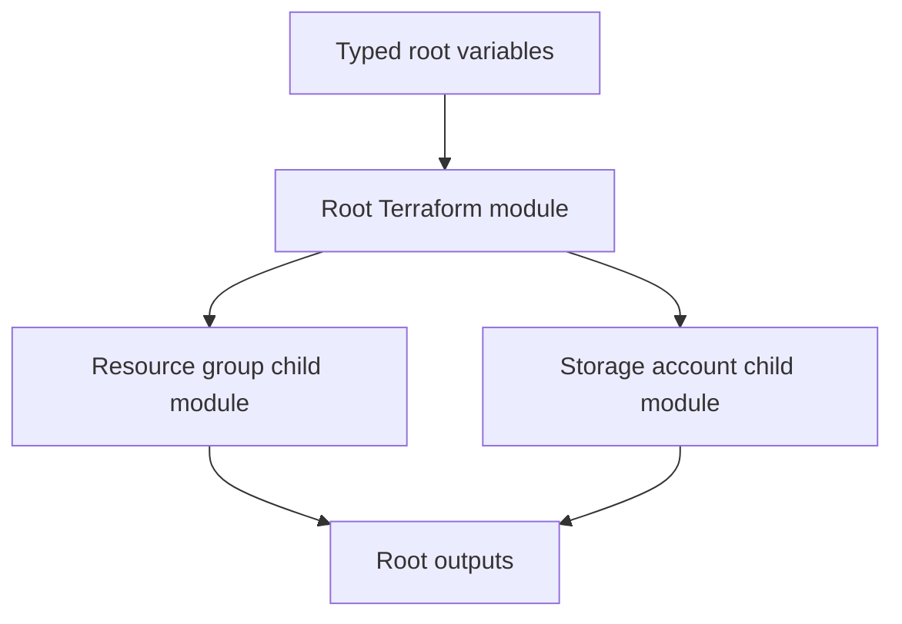

# Terraform Azure Storage Modules

> **Status:** Reusable Terraform module learning project with a root composition layer, typed inputs, outputs, secure storage defaults and GitHub Actions validation. This is not a deployed production platform.

## Architecture



## Modules

| Module | Responsibility |
|---|---|
| `azurerm_resource_group` | Create one or more resource groups with `for_each` |
| `azurerm_storage_account` | Create one or more StorageV2 accounts with secure transport/network defaults |

The root module composes both child modules. Storage account resource group names are explicit inputs; ensure each referenced group is created by this configuration or already exists in the target subscription.

## Prerequisites

- Terraform CLI 1.6+
- Azure CLI authenticated to a test subscription
- Permission to create resource groups and storage accounts

## Validate

```bash
terraform fmt -check -recursive
terraform init -backend=false
terraform validate
```

## Configure a plan

Copy `terraform.tfvars.example` to `terraform.tfvars`, choose a globally unique storage account name (3–24 lowercase letters/numbers), and review the full plan:

```bash
terraform plan -out=tfplan
terraform show -no-color tfplan
```

Apply only after approval. This repository does not configure remote state or create private endpoints. Storage accounts default to public network access disabled and shared-key access disabled, so a workload will need an approved private endpoint/VNet path and Microsoft Entra data-plane authorization before it can access blob data.

## Security

- HTTPS-only, TLS 1.2 minimum, shared-key authentication disabled and public network access disabled.
- Do not commit Terraform state, plan files, credentials or real `*.tfvars`.
- Configure encrypted remote state, access control, versioning and locking before team use.
- Add private endpoints, private DNS and scoped RBAC assignments for a real workload; validate DNS and data-plane access from the intended network.

## CI

GitHub Actions checks formatting and validates the root module with a backend-free initialization. CI does not deploy Azure resources or validate subscription permissions.

## Author

MD Amirul Haque · [GitHub profile](https://github.com/haqueamir70-coder) · [LinkedIn](https://www.linkedin.com/in/md-amirul-haque/)
