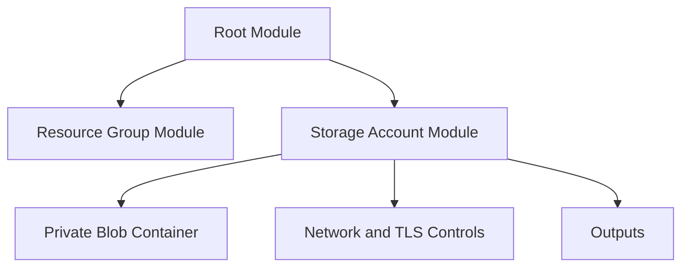

<div align="center">


[](https://developer.hashicorp.com/terraform)
[](https://azure.microsoft.com/)
[](https://github.com/haqueamir70-coder)

</div>

> **Portfolio project:** implementation status and limitations are documented below. The diagram describes the intended workflow/architecture and is not proof of a successful production deployment.

## 🗺️ Architecture at a Glance



---

# Terraform Azure Storage and Resource Modules

A practice repository for learning how to organize Azure resources into reusable Terraform modules.

## Current layout

The repository includes directories for an Azure resource group and Azure storage account, along with a parent-module path. Inspect the directory contents to verify the exact implementation and module wiring.

## Suggested validation workflow

Run from the Terraform root module:

```bash
terraform fmt -check -recursive
terraform init
terraform validate
terraform plan
```

Review the plan carefully before applying resources to Azure. Storage resources can incur charges, so use a test subscription and clean up resources when finished.

## Module documentation checklist

For each module, document:

- Purpose and resources created
- Required and optional input variables
- Outputs and how callers consume them
- Example usage
- Provider and version requirements
- Naming, region, security, and cost considerations
- Validation steps and safe cleanup instructions

## Security notes

- Do not commit credentials, state files, or real secret-bearing variable files.
- Keep storage network access and public access disabled unless there is a clear requirement.
- Prefer Microsoft Entra ID/RBAC where supported and grant least privilege.
- Enable appropriate encryption, logging, retention, and recovery controls for the intended workload.

## Author

MD Amirul Haque · [GitHub profile](https://github.com/haqueamir70-coder) · [LinkedIn](https://www.linkedin.com/in/md-amirul-haque/)
