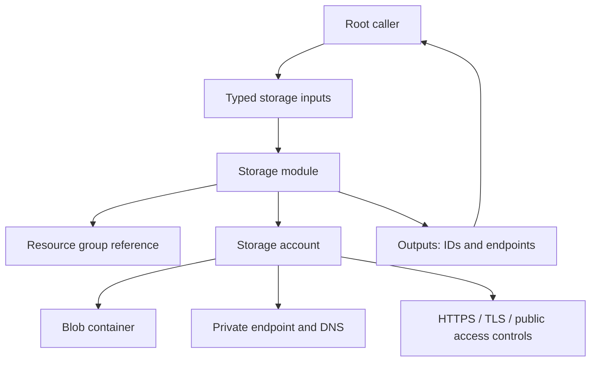

# Reusable Azure Storage Terraform module — Architecture & Interview Guide

Root-to-child module composition for Azure Storage. Security defaults should be reviewed against workload requirements, including private connectivity, encryption, retention and diagnostics.

## Architecture diagram

## Interview questions

1. 1. Which Azure Storage security settings should be enabled by default?
2. 2. What is the difference between account-level and container-level access?
3. 3. Why disable Shared Key authorization where possible?
4. 4. How do private endpoints and private DNS work together?
5. 5. How do you configure blob versioning and soft delete?
6. 6. What is the difference between LRS, ZRS, GRS and GZRS?
7. 7. How do lifecycle management rules reduce cost?
8. 8. How do you expose outputs without leaking secrets?
9. 9. How would you test a storage module using Terraform validation and Checkov?
10. 10. How do you safely change a storage account without data loss?

## Interview preparation note
For each answer, cover the design rationale, trust boundary, failure mode, operational telemetry and validation method. Distinguish implemented, CI-validated, cloud-deployed and planned capabilities.

## Interview questions — suggested answers

### 1. Answer

Enable HTTPS-only, TLS 1.2+, secure transfer, encryption, minimum required public access, private connectivity where needed, identity-based access and diagnostics.

### 2. Answer

Account-level settings define service capabilities and network/security defaults; container-level settings govern individual blob access and permissions.

### 3. Answer

Shared Key grants broad account-key access and is hard to scope/audit per identity. Entra ID/RBAC provides role-based, identity-centric authorization.

### 4. Answer

Private endpoint assigns a private IP in the VNet; private DNS links the service FQDN to that address for clients on linked networks.

### 5. Answer

Versioning preserves prior blob versions; soft delete retains deleted blobs/containers for a configured period. Both help recovery but increase storage cost.

### 6. Answer

LRS stores locally redundant copies, ZRS synchronously spans zones, GRS replicates to a paired region asynchronously, and GZRS combines zone and geo redundancy.

### 7. Answer

Lifecycle rules transition or delete blobs based on age, access tier or prefix. Test rules carefully to avoid deleting active data.

### 8. Answer

Outputs should expose non-secret IDs, names and endpoints. Do not output account keys, SAS tokens or credentials; mark sensitive values where unavoidable.

### 9. Answer

Use fmt/init/validate, TFLint and Checkov, plus tests for input validation and secure configuration. Add an integration test only in a controlled subscription.

### 10. Answer

Plan changes, verify data retention and replication requirements, back up/migrate data, avoid replacement of populated accounts, and use staged changes with rollback.

## Complete zero-to-hero guide

See [ZERO-TO-HERO.md](./ZERO-TO-HERO.md) for the business scenario, architecture walkthrough, tool-by-tool explanations, implementation sequence, practical commands, troubleshooting playbook and additional scenario-based interview questions with answers.
