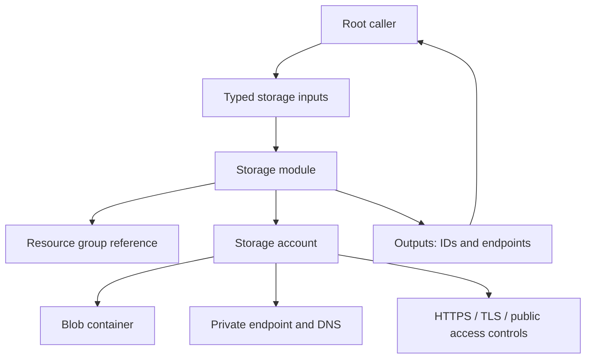

# Reusable Azure Storage Terraform module — Architecture & Interview Guide

Root-to-child module composition for Azure Storage. Security defaults should be reviewed against workload requirements, including private connectivity, encryption, retention and diagnostics.

## Architecture diagram

## Interview questions

1. 1. Which Azure Storage security settings should be enabled by default?
2. 2. What is the difference between account-level and container-level access?
3. 3. Why disable Shared Key authorization where possible?
4. 4. How do private endpoints and private DNS work together?
5. 5. How do you configure blob versioning and soft delete?
6. 6. What is the difference between LRS, ZRS, GRS and GZRS?
7. 7. How do lifecycle management rules reduce cost?
8. 8. How do you expose outputs without leaking secrets?
9. 9. How would you test a storage module using Terraform validation and Checkov?
10. 10. How do you safely change a storage account without data loss?

## Interview preparation note
For each answer, cover the design rationale, trust boundary, failure mode, operational telemetry and validation method. Distinguish implemented, CI-validated, cloud-deployed and planned capabilities.
